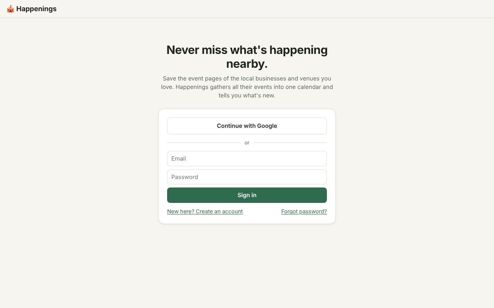

# Happenings

<!-- site-summary:start -->
<!-- This section is this project's card on https://mendus59.github.io and is copied there daily.
     Keep it true of what's on main: one plain-text summary line (max 160 characters), then 1-6 short bullets.
     See CLAUDE.md ("Site summary"). -->
One calendar for the events at the small businesses and venues you love.

- Save any venue's events page and Happenings checks it every few hours, gathering everything into one list and calendar.
- New events stay highlighted until you mark them Interested, Favorite or Hide, and are sorted into types like Live Music, Comedy and Markets.
- Events you planned on that change or vanish from the venue's page are flagged, so you know a plan changed.
- Draw your own area on a map to find places nearby, new Washington openings from liquor-license notices, and closings.
- A Restaurants tab with separate dine-in, takeout and delivery areas, favorites and dislikes for each, and search across menu dishes.
- Try a demo with sample venues and events without an account, or sign in with Google or email to follow your own.
<!-- site-summary:end -->

<!-- site-screenshot: docs/screenshot.jpg -->


One calendar for the events at the small businesses and venues you love.

Save the events page of any venue (a cidery's music calendar, a foraging guide's tour
bookings, a bookstore's readings…). Happenings checks those pages every few hours and
gathers everything into a single list and calendar. New events are highlighted until you
review them: mark them **Interested**, **Favorite**, or **Hide** them. Events are sorted into
types (Live Music, Comedy, Workshops, Markets…) so you can filter to what you like.

Everything runs on free tiers: GitHub Pages hosts the app, GitHub Actions does the
scraping, and Firebase (Spark plan) handles sign-in and data.

## How it works

```
 venue websites ──► GitHub Actions (hourly) ──► Firestore ◄── web app on GitHub Pages
                    headless Chromium scraper    venues/{id}/events     (signed-in users)
                                                 users/{uid}/...
```

- **Scraper** (`scraper/`): a scheduled GitHub Actions job loads each saved page in headless
  Chromium (so JavaScript calendar widgets render), then pulls events out using, in order:
  schema.org JSON-LD and microdata, iCal feeds and Google Calendar embeds, Acuity Scheduling
  classes, Squarespace event collections, WordPress "The Events Calendar", and finally a
  text heuristic. If you paste a homepage, it follows likely "Events / Calendar / Tours" links.
  Each event is auto-categorized by keywords.
- **Sync**: new events are added, changed ones updated, and future events that vanish from the
  venue's page are marked *removed* (you'll still see them, struck through, if you'd marked
  them Interested or Favorite, so you know a plan changed). Old events are purged after 30 days.
- **Web app** (`web/`): plain JavaScript bundled with esbuild. Reads live from Firestore.
- **Security** (`firestore.rules`): venue/event data is read-only to signed-in users and written
  only by the scraper. Each user's saved venues and review states are private to them.

Venue data is shared: if two people save the same page it's only scraped once.

## One-time setup

These need your hands in the GitHub and Firebase consoles (about 10 minutes).

**1. Firebase: create the database**
Firebase console → *Build → Firestore Database* → **Create database** → Production mode → pick a
US location (e.g. `us-west1`). Stay on the free Spark plan.

**2. Firebase: turn on sign-in**
*Build → Authentication* → **Get started** → *Sign-in method* → enable **Google** and
**Email/Password**. Then *Settings → Authorized domains* → **Add domain** → `mendus59.github.io`.

**3. Firebase: create a service account key for the scraper**
⚙️ *Project settings → Service accounts* → **Generate new private key**. A JSON file downloads.
Keep it private; don't commit it.

**4. GitHub: add the key as a secret**
Repo → *Settings → Secrets and variables → Actions* → **New repository secret** → Name
`FIREBASE_SERVICE_ACCOUNT`, value: paste the entire contents of that JSON file.

**5. GitHub: turn on Pages**
Repo → *Settings → Pages* → *Build and deployment* → Source: **GitHub Actions**.

**6. Publish the security rules**
*Firestore Database → Rules* → paste the contents of `firestore.rules` → **Publish**. Do this
again whenever that file changes. (The scraper's service account can't publish rules on its own,
so this stays a manual step.)

After merging to `main`, the app is live at **https://mendus59.github.io/Happenings/**. To get
events right away instead of waiting for the hourly run: *Actions → Sync venue events → Run
workflow*.

## Nearby (location features)

The **Nearby** tab lets each person draw an area on the map around the places they actually go: any shape with 3 to 16 corners, rather than a radius, so water or mountains can be left out. Only the shape's corners are saved, rounded to about 1 km. The daily jobs work from each shape's bounding box; the app then keeps only what falls inside the shape. Everything uses free, public data:

- **Map and places**: OpenStreetMap tiles, the Overpass API for places, and Nominatim for town search. Click a place with a website to start tracking its events.
- **Openings**: Washington State Liquor and Cannabis Board license notices ([data.wa.gov](https://data.wa.gov/d/vgcw-qfjm)), checked daily by `.github/workflows/local.yml`. Most new restaurants, bars, breweries and wineries file one before opening. This only covers Washington.
- **Closings**: there is no free closure registry, so closings come from three signals: a "we're closing" notice on a tracked venue's own site, a tracked site that has been unreachable for several days, and places that disappear from or are marked closed on OpenStreetMap (compared every 28 days).
- **Suggestions** (opt in): places with websites inside the area, ranked by how much they resemble the venues and events you already track.

## Restaurants

The **Restaurants** tab has its own three map areas (any shape, like the Nearby area): **dine-in**, **takeout** and **delivery**. Each restaurant can be marked favorite or disliked separately for each of the three, and restaurants with no rating are flagged "Unrated". You can filter by way of eating, cuisine, price, menus, and favorites or dislikes (for example, only takeout favorites, or hide anything disliked for delivery). Search covers restaurant names, cuisines and **dishes on their menus**.

Everything is free:

- **Restaurant list**: OpenStreetMap, which also provides cuisine and, where mapped, whether a place offers takeout or delivery. Refreshed weekly by `.github/workflows/restaurants.yml`.
- **State license records**: every night the jobs read the Liquor and Cannabis Board's free "On Premise Licensees" spreadsheet (every restaurant, tavern and bar licensed or applying to serve alcohol) and place each address on the map with the free US Census geocoder (cached). Licensed restaurants that aren't on OpenStreetMap yet still show up, and new licenses appear in "New & closing".
- **Opening dates**: from Washington liquor-license notices and the licensee list (saved, since the state's feed only keeps recent ones), the map's own start date when mappers recorded one, or the day the nightly check first found the place on the map. Sort by **Newest first** to see them. Places that filed a license notice but aren't on the map yet are listed as "Coming soon?" for up to a year.
- **New areas** get their restaurant list within the hour (from the hourly job); menus follow overnight.
- **Menus**: read from each restaurant's **own website**, about once a month per restaurant. The job uses schema.org menu data, common menu widgets (Squarespace, BentoBox, Popmenu and similar), plain-text menus, and PDF menus. It can't read menus that are images. Prices come from these menus, so "$–$$$$" is an estimate.
- **Ordering links**: DoorDash, Grubhub, Uber Eats, Toast, Square and other ordering links found on the restaurant's site. A link to a delivery app also marks the restaurant as offering delivery. The delivery apps have no free way to read their listings or menus, so for other restaurants the app shows "Look for it on DoorDash / Grubhub / Uber Eats" search links.
- **New and closing restaurants**: the same daily license and map checks as Nearby, plus closing notices on a restaurant's own website.

## Free-tier budget

| Service | Free limit | Typical use |
| --- | --- | --- |
| GitHub Actions | Unlimited minutes for public repos | ~1–3 min per run, hourly |
| GitHub Pages | 100 GB/month bandwidth | ~200 KB per visit |
| Firestore (Spark) | 50k reads, 20k writes per day | writes only when events change |
| Firebase Auth | 50k monthly active users | |

The scraper only writes when something actually changed, scans at most 60 venues per run, and
re-reads each venue every 6 hours (`SCRAPE_INTERVAL_HOURS` in `scrape.yml`). Restaurant lists
are stored a few hundred restaurants per document, so opening the Restaurants tab costs only a
handful of reads. The restaurants job visits at most 120 websites per night (`MENU_BUDGET`).

## Development

```sh
npm install
npm test             # scraper + URL unit tests
npm run test:rules   # security rules tests against the Firestore emulator (needs Java)
npm run build        # bundle the web app into web/dist

# Try the whole app locally with demo data, no production access needed:
npx firebase-tools emulators:start --only auth,firestore   # terminal 1
npm run seed && npm run dev                                 # terminal 2
# open http://localhost:5173/?emulator and sign in as demo@example.com / demo-password

# See what the scraper finds on any page (no Firestore):
npx playwright install chromium
npm run scrape:dry -- --url https://www.finnriver.com/farm-music-event-calendar
```

### Adding support for another site

If a venue's events aren't picked up, run the dry-run command above on its URL. Most fixes
are a new adapter in `scraper/src/extract/` (see `acuity.js` for an example) plus a fixture
test in `scraper/test/`. Category keywords live in `scraper/src/categorize.js`.
